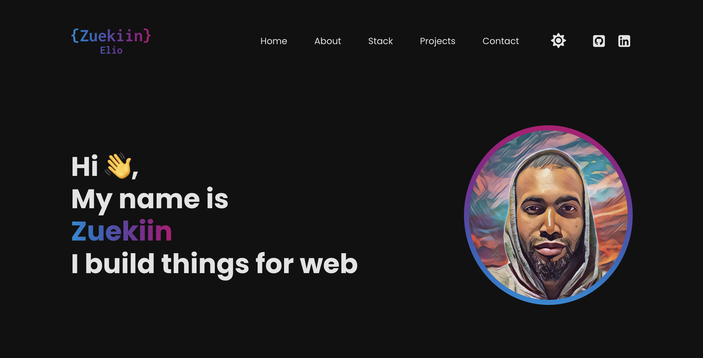
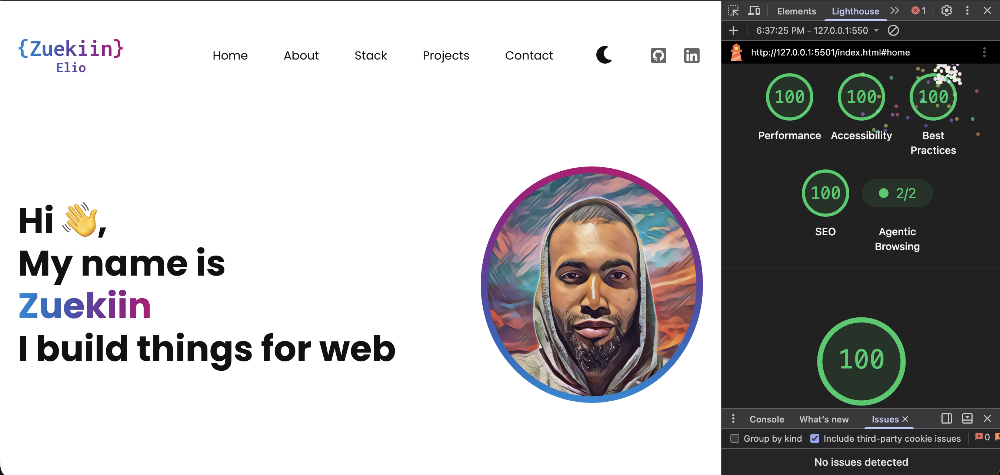
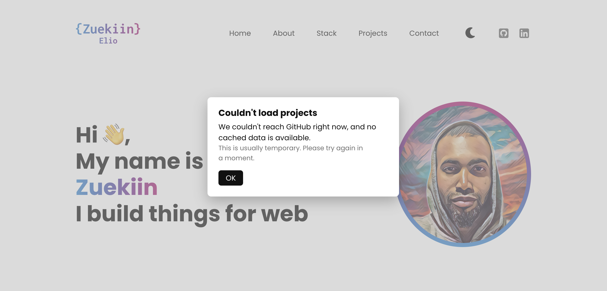
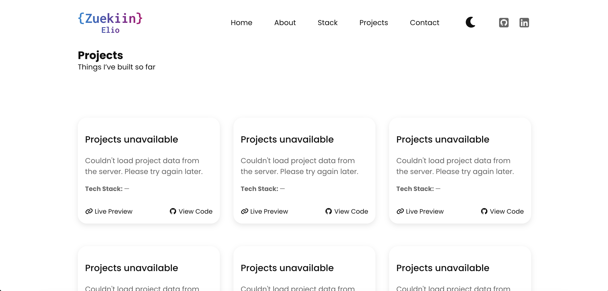

# README Portfolio (u02)

**Publicerad sida:** []

---

## Vad u02 lägger till

u01 var en statisk sida byggd för hand. I u02 hämtas innehållet istället vid laddning: projekt från **GitHubs API** och CV-data från en **JSON-fil** jag skrivit själv. Sidan har också fått fungerande hamburgermeny, temaväxling som sparas, scroll-spy och en felmodal. HTML-stommen, semantiken och layouten från u01 ligger kvar  det är datan och interaktionen som är ny.

---

## Datans väg  ett GitHub-anrop från start till skärm

När sidan laddas körs `fetchProjects()`. Första steget är `readCache()`, som läser `localStorage` under nyckeln `portfolio_repos`. Finns ett objekt med `data` och `ts` och `Date.now() - cached.ts < TTL` (6 timmar) returneras cachen direkt  inget nätverkstanrop.

Vid cache miss anropas `https://api.github.com/users/zuekiin/repos`. Svaret är en array av repobjekt med `name`, `html_url`, `description` m.m. Koden filtrerar med `wanted.includes(r.name)` så bara mina sex utvalda repon blir kvar. Språklistan finns inte i det svaret, så ett andra anrop görs per repo mot `/languages` med `Promise.all`. Varje sådant anrop fångas med `.catch(() => ({}))` så ett enskilt misslyckat språkanrop inte fäller hela kedjan.

Resultatet mappas till `{ name, url, description, languages }`, sparas med `writeCache()` och skickas till `renderCards()`. Först där byggs DOM och något syns på skärmen. Ordningen är medveten: filtrera → berika → normalisera → rendera. Renderingen vet inget om GitHub, bara om det normaliserade objektet.

## Två datakällor  varför de behandlas olika

`resume.json` är *min* fil: samma origin, snabbt svar, format jag själv bestämt. Där läser jag fält rakt av (`data.hero.name`, `job.startDate`) och har bara `.catch()` för loggning.

GitHub är *någon annans* API: asynkront, kan rate-limitas (403), kan svara långsamt, och formatet råder jag inte över. Därför har projektflödet cache, tvåstegsanrop, stale-cache-fallback och modal. Jag behandlar källorna olika för att deras riskprofil är olika  inte för att koden är inkonsekvent.

## DOM och händelser

Innehållet byggs genom att `container.innerHTML = ""` följt av `document.createElement("article")` och `appendChild`  jag rör aldrig befintlig markup, jag ersätter den. Händelser lyssnar jag på där de hör hemma:

- `click` på `.hamburger-btn` togglar `is-open` på nav-containern och sätter `aria-expanded`.
- `change` på `#toggleMode` byter tema och sparar valet.
- `keydown` (Escape) stänger felmodalen.
- `IntersectionObserver` med `rootMargin: "-40% 0px -55% 0px"` driver scroll-spy.

Jag valde observer framför scroll-listener för att den bara rapporterar när en sektion korsar en linje, inte vid varje pixel. `scroll`-lyssnaren finns bara som komplement för att tvinga `#home` nära toppen.

## Markup jag inte skrivit för hand

Eftersom `renderCards()` genererar HTML i template-strängar måste den vara semantisk på egen hand. Varje kort är ett `<article>` med `<figure>`, `<header><h3>`, `
` och `<footer>`  samma struktur som i u01, inte `
`-soppa. Bilden har `alt` satt till projektnamnet, `width`/`height` för att undvika layoutskift. Länkarna är riktiga `<a>` med `rel="noopener noreferrer"`, inte klickbara divs. Rubriknivån `h3` är vald för att passa under sektionens `h2`.

## Temaväxlingen

Temat styrs av klassen `dark-mode` på `<html>` och CSS-variabler i `:root`. JavaScript sätter bara klassen och sparar valet i `localStorage`  det rör aldrig färgvärden. Hade jag satt färger direkt i JS hade varje ny komponent krävt en JS-ändring, `prefers-color-scheme` hade inte kunnat samverka, och CSS:en hade tappat sitt enda sanningsvärde. Nu räcker en klass för att byta allt.

## När det inte går som tänkt

Tre lägen hanteras:

- **Laddning:** korten renderas när datan är klar. Ingen skeleton visas än  en brist.
- **Fel:** om `res.ok` är falskt och cache finns används *stale cache* med konsolvarning. Finns ingen cache kastas felet, `showErrorModal()` visar modal och `renderErrorCards()` ritar sex begripliga kort med texten "Projects unavailable".
- **Tom lista:** om GitHub svarar 200 men inga `wanted`-namn matchar blir
  `selected` tom. `fetchProjects()` kastar då ett fel innan något hunnit
  cachas, så samma `catch`-kedja som vid nätverksfel används: finns stale
  cache visas den, annars visas `showErrorModal()` och
  `renderErrorCards(wanted.length)` ritar sex kort med "Projects
  unavailable". Tomt svar behandlas alltså som ett fel, inte som ett lyckat
  svar, och cachas aldrig.

Sidan fungerar alltså även om GitHub svarar långsamt eller inte alls, så länge det finns cache. Utan cache och utan nätverk får besökaren modalen istället för en trasig sida.

## Tillgänglighet  testat hela vägen

- **Tangentbord:** hela sidan går att tabba igenom i logisk ordning. Hamburgermenyn är en riktig `<button>` med `aria-expanded` och `aria-controls`, inte en div. Fokusmarkeringen kommer från `:focus-visible { outline-offset: 0.2rem; }` i `reset.css`.
- **Genererad markup:** korten från `renderCards()` har samma rubrikhierarki och element som u01  `<article>`, `<figure>`, `<header>`, `<footer>`. Länkarna är `<a>`.
- **Kontrast:** färgerna i `:root` är valda för WCAG AA i både ljust och mörkt läge.
- **Modal:** stängs med Escape och `[data-close]`, `hidden`-attributet används istället för att bara dölja med CSS.

Jag testade med Lighthouse och fick **100 i Accessibility, Performance, Best Practices och SEO**  skärmdumpar nedan.

## Styrkor och brister

**Styrkor:** felkedjan cache → färskt anrop → stale cache → modal, att språkanropen är isolerade per repo, att temaväxlingen bara rör en klass, och att genererad markup är lika semantisk som den handskrivna.

**Brister:** Alla sex korten får samma src, bara alt skiljer sig. Besökaren kan inte se skillnad på projekten visuellt, och alt blir missvisande eftersom bilden inte föreställer projektet. En brist i både UX och tillgänglighet då github inte har några bra bilder för projekten.

## AI-verktyg

Jag använde AI för att strukturera cache/TTL-logiken. Det jag ändrade: AI föreslog globala brytpunkter och en enklare felhantering som bara loggade. Jag bytte till elementdrivna brytpunkter och byggde ut felkedjan med stale cache och modal, eftersom ett tomt svar eller rate-limit annars lämnar besökaren utan förklaring. Jag granskade varje genererat block mot min egen kod innan jag behöll det.